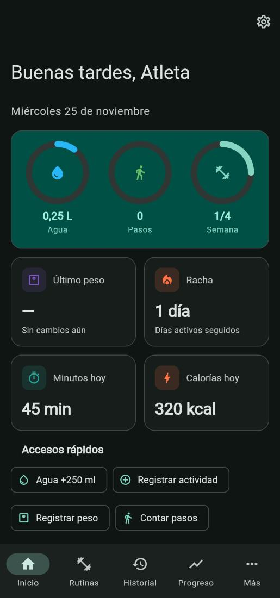
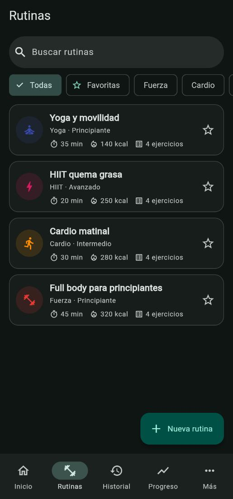
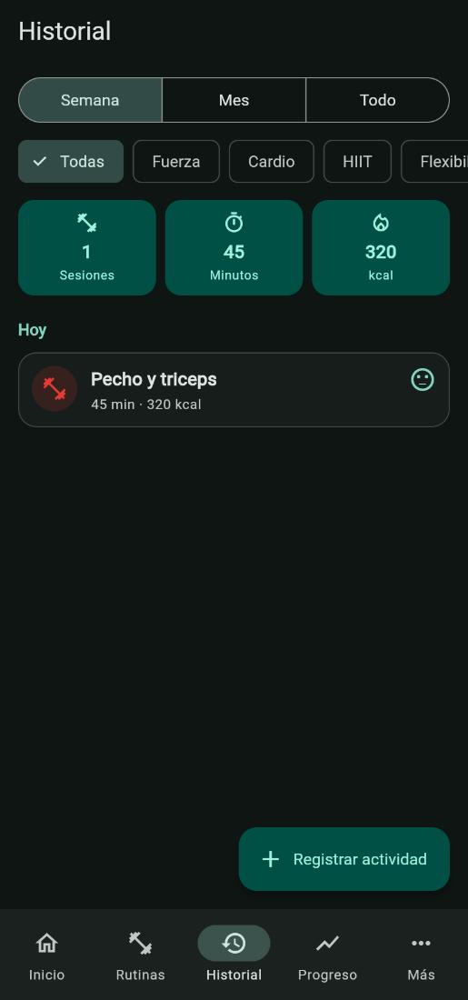
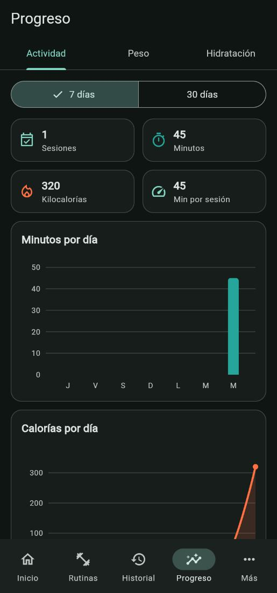
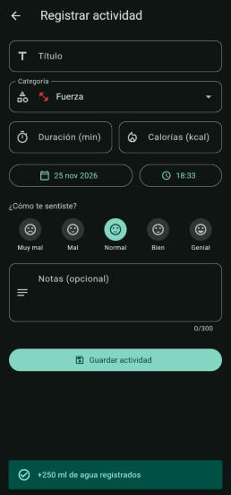

# FitLife

**Tu compañero de entrenamiento, peso, hidratación y pasos.** FitLife es una aplicación Flutter que reúne en un solo lugar el registro de rutinas, el historial de actividades, el seguimiento de peso, la hidratación diaria, un contador de pasos con acelerómetro y desafíos semanales, con gráficos estadísticos y todos los datos guardados localmente en SQLite.


Proyecto universitario — **Equipo 4**. Repositorio: <https://github.com/GendrickAlv/fitlife>

> La aplicación funciona en **Android**, en **web (Chrome)** y en **Windows**. La interfaz está en español y soporta tema claro y oscuro (Material 3).

## Capturas de pantalla

| Inicio | Rutinas | Historial |
|:---:|:---:|:---:|
|  |  |  |

| Progreso | Formulario |
|:---:|:---:|
|  |  |

## Funcionalidades

- **Registro de rutinas**: crear, ver, editar y eliminar rutinas con lista de ejercicios (series, repeticiones, peso y descanso), categoría, dificultad, favoritas, búsqueda y filtros. Se incluyen 4 rutinas de ejemplo.
- **Historial de actividades**: registrar entrenamientos (también a partir de una rutina), filtrar por periodo y categoría, editar y eliminar con *Deshacer*.
- **Seguimiento de peso**: registros con fecha y nota, variación, IMC y gráfico de evolución.
- **Hidratación**: botones rápidos (150, 250, 330 y 500 ml), cantidad personalizada, meta diaria y gráfico semanal.
- **Sensor de pasos**: contador con acelerómetro (`sensors_plus`) y alternativa manual si el dispositivo no lo soporta.
- **Desafíos semanales**: cinco tipos de desafío cuyo progreso se calcula a partir de los demás datos.
- **Progreso**: gráficos de barras, líneas y circular con `fl_chart` (7 o 30 días).
- **Perfil y ajustes**: nombre, estatura, peso objetivo, metas y tema (claro, oscuro o sistema).

## Cumplimiento de requisitos

| Requisito | Cómo se cumple | Archivo(s) |
|---|---|---|
| Flutter & Dart | App Flutter con Dart 3.14, Material 3 y análisis estático sin incidencias | `pubspec.yaml`, `lib/` |
| Interfaz profesional | Tema Material 3 claro/oscuro con `ColorScheme.fromSeed`, estados vacíos, `ProgressRing`, tarjetas y SnackBars | `lib/core/theme/app_theme.dart`, `lib/widgets/` |
| Navegación | `NavigationBar` con 5 pestañas (`IndexedStack`) y `Navigator.push` a pantallas secundarias | `lib/screens/shell/home_shell.dart`, `lib/screens/more/more_screen.dart` |
| Formularios con validación | `Form` + `TextFormField` con la clase `Validators` y reglas por campo | `lib/core/utils/validators.dart`, `lib/screens/routines/form_helpers.dart`, formularios en `lib/screens/**` |
| Consumo de datos local | Repositorios sobre SQLite y SharedPreferences; datos de ejemplo al crear la base | `lib/data/repositories/`, `lib/data/database/app_database.dart` |
| CRUD completo | Crear, leer, actualizar y eliminar en rutinas, actividades, peso, agua y desafíos | `lib/data/repositories/*_repository.dart`, `lib/providers/` |
| Gestión de estado | `Provider` + `ChangeNotifier` con `MultiProvider` | `lib/app.dart`, `lib/providers/` |
| Persistencia SQLite | `sqflite` (móvil), `sqflite_common_ffi` (escritorio) y `sqflite_common_ffi_web` (web) | `lib/data/database/` |
| Registro de rutinas | Pantallas de lista, detalle y formulario | `lib/screens/routines/` |
| Seguimiento de peso | Lista, formulario, resumen e IMC, gráfico | `lib/screens/weight/`, `lib/providers/weight_provider.dart` |
| Hidratación | Registro rápido, meta diaria y gráfico | `lib/screens/hydration/`, `lib/providers/hydration_provider.dart` |
| Historial de actividades | Lista filtrable con edición y borrado con deshacer | `lib/screens/history/` |
| Gráficos estadísticos | `fl_chart`: barras, líneas y circular | `lib/screens/stats/`, `lib/screens/weight/weight_chart.dart`, `lib/screens/hydration/hydration_chart.dart` |
| Integración con sensores | Acelerómetro con detección de picos | `lib/providers/step_provider.dart`, `lib/screens/sensors/step_counter_screen.dart` |
| Desafíos semanales | Tipos, formulario y progreso calculado | `lib/providers/challenge_provider.dart`, `lib/screens/challenges/` |
| Documentación técnica | Documentación técnica, manual de usuario y guion de presentación | [`docs/`](docs/) |
| Repositorio GitHub | Código publicado en GitHub | <https://github.com/GendrickAlv/fitlife> |

## Stack tecnológico

| Área | Tecnología |
|---|---|
| Framework | Flutter 3.50 (UI en el paquete `material_ui`) y Dart `^3.14.0` |
| Estado | `provider` ^6.1.5+1 |
| Base de datos | `sqflite` ^2.4.6, `sqflite_common_ffi` ^2.4.7, `sqflite_common_ffi_web` ^1.2.2, `path` |
| Preferencias | `shared_preferences` ^2.5.6 |
| Gráficos | `fl_chart` ^1.3.1 |
| Sensores | `sensors_plus` ^7.1.1 |
| Internacionalización | `intl` ^0.20.3 y `flutter_localizations` (locale `es`) |
| Calidad | `flutter_lints` ^6.0.0, `flutter_test` |

## Estructura del proyecto

```text
fitlife/
├── lib/
│   ├── main.dart                 # Inicializa la fábrica de BD, intl y arranca la app
│   ├── app.dart                  # MultiProvider + MaterialApp (tema, localización)
│   ├── core/
│   │   ├── constants.dart        # Categorías, dificultades, ChallengeType, metas por defecto
│   │   ├── theme/app_theme.dart
│   │   └── utils/                # date_utils, formatters, validators
│   ├── data/
│   │   ├── database/             # app_database.dart y db_platform{,_io,_web}.dart
│   │   ├── models/               # routine, activity, weight_entry, water_entry,
│   │   │                         # challenge, step_record, user_profile
│   │   └── repositories/         # un repositorio por tabla + profile (SharedPreferences)
│   ├── providers/                # routine, activity, weight, hydration, challenge, step, profile
│   ├── screens/
│   │   ├── shell/                # HomeShell (NavigationBar)
│   │   ├── dashboard/            # Inicio
│   │   ├── routines/             # lista, detalle, formulario, hoja de ejercicio
│   │   ├── history/              # historial y formulario de actividad
│   │   ├── stats/                # Progreso (pestañas y gráficos)
│   │   ├── more/                 # menú "Más"
│   │   ├── weight/  hydration/  challenges/  sensors/  settings/
│   └── widgets/                  # EmptyState, StatCard, SectionHeader, ConfirmDialog,
│                                 # ProgressRing, AppSnack
├── test/                         # 13 archivos de prueba
├── docs/                         # Documentación, manual, presentación y capturas
├── web/                          # index.html, sqlite3.wasm, sqflite_sw.js
├── android/  windows/
└── pubspec.yaml
```

## Instalación y ejecución

### Requisitos previos

1. Instalar el SDK de Flutter siguiendo la [guía oficial](https://docs.flutter.dev/get-started/install) (Dart 3.14 o superior).
2. Comprobar el entorno con `flutter doctor`.
3. Clonar el repositorio e instalar dependencias:

```bash
git clone https://github.com/GendrickAlv/fitlife.git
cd fitlife
flutter pub get
```

### Android

Con un dispositivo físico (depuración USB) o un emulador:

```bash
flutter run
```

### Web (Chrome)

```bash
flutter run -d chrome
```

En web, SQLite se ejecuta compilado a WebAssembly mediante `sqflite_common_ffi_web`. Por eso el proyecto incluye los archivos `web/sqlite3.wasm` y `web/sqflite_sw.js`, que deben permanecer en la carpeta `web/`. Los datos se guardan en el navegador (IndexedDB). El acelerómetro puede no estar disponible en escritorio; en ese caso la pantalla de pasos ofrece el registro manual.

### Windows

```bash
flutter run -d windows
```

Requiere Visual Studio con la carga de trabajo **"Desarrollo para el escritorio con C++"** (Desktop development with C++) y el **Modo de desarrollador** de Windows activado (necesario para los enlaces simbólicos de los plugins).

### Pruebas y análisis

```bash
flutter test      # 54 casos de prueba en 13 archivos
flutter analyze   # sin incidencias
```

## Documentación

- [Documentación técnica](docs/DOCUMENTACION_TECNICA.md)
- [Manual de usuario](docs/MANUAL_USUARIO.md)
- [Guion de presentación y defensa](docs/PRESENTACION.md)

## Equipo

**Equipo 4 — integrantes:**

- TODO: nombre del integrante 1
- TODO: nombre del integrante 2
- TODO: nombre del integrante 3
- TODO: nombre del integrante 4

## Licencia

Este proyecto se distribuye bajo la licencia **MIT**. Consulta el archivo `LICENSE`.
