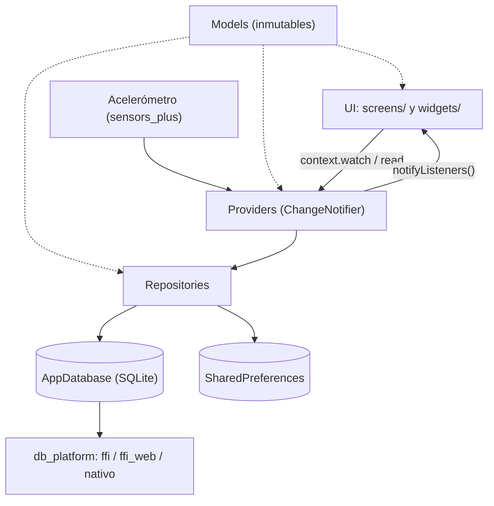
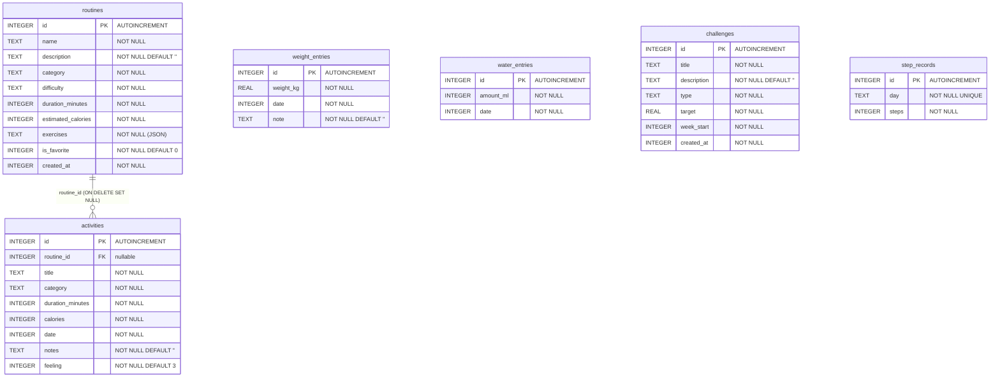
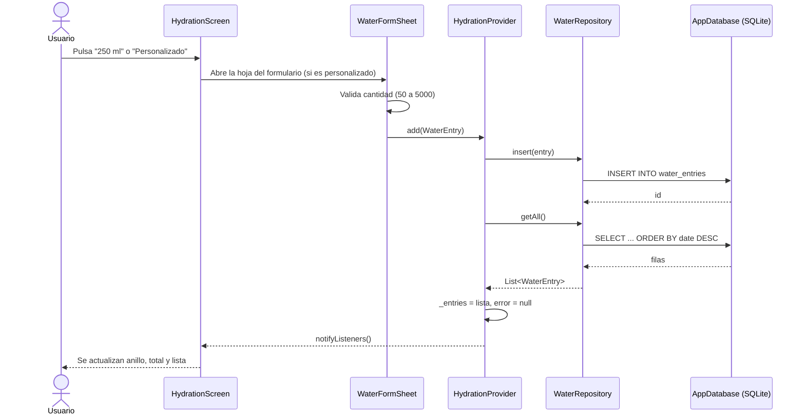
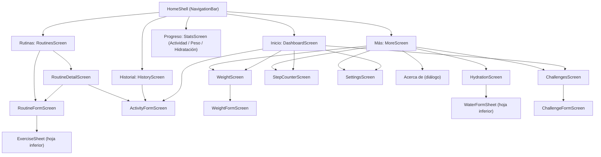

# FitLife — Documentación técnica

Proyecto universitario, Equipo 4. Versión de la aplicación: 1.0.0+1.

## Índice

1. [Introducción y objetivos](#1-introducción-y-objetivos)
2. [Alcance y requisitos](#2-alcance-y-requisitos)
3. [Arquitectura](#3-arquitectura)
4. [Modelo de datos](#4-modelo-de-datos)
5. [Gestión de estado](#5-gestión-de-estado)
6. [Persistencia](#6-persistencia)
7. [Navegación](#7-navegación)
8. [Formularios y validación](#8-formularios-y-validación)
9. [Gráficos](#9-gráficos)
10. [Sensores](#10-sensores)
11. [Desafíos semanales](#11-desafíos-semanales)
12. [Pruebas](#12-pruebas)
13. [Calidad](#13-calidad)
14. [Limitaciones y trabajo futuro](#14-limitaciones-y-trabajo-futuro)
15. [Glosario](#15-glosario)

---

## 1. Introducción y objetivos

FitLife es una aplicación móvil y multiplataforma (Android, web y Windows) desarrollada con Flutter y Dart. Permite registrar rutinas de ejercicio, llevar un historial de actividades, controlar el peso y la hidratación, contar pasos con el acelerómetro y plantearse desafíos semanales, con estadísticas gráficas. Todos los datos se almacenan **localmente** en el dispositivo: no hay servidor ni cuentas de usuario.

**Objetivos**

- Aplicar los conceptos del curso: interfaz profesional, navegación, formularios con validación, CRUD completo, gestión de estado y persistencia SQLite.
- Integrar funcionalidades avanzadas: gráficos estadísticos, sensor de acelerómetro y desafíos semanales.
- Mantener una arquitectura por capas, legible y verificable con pruebas automatizadas.

## 2. Alcance y requisitos

### Requisitos funcionales

| ID | Requisito |
|---|---|
| RF-01 | Crear, listar, ver, editar y eliminar rutinas con ejercicios (series, repeticiones, peso opcional, descanso opcional). |
| RF-02 | Marcar rutinas como favoritas, buscarlas por texto y filtrarlas por categoría o favoritas. |
| RF-03 | Registrar actividades realizadas, de forma manual o precargadas desde una rutina. |
| RF-04 | Listar el historial de actividades filtrando por periodo (semana, mes, todo) y por categoría; editar y eliminar con opción de deshacer. |
| RF-05 | Registrar, editar y eliminar pesos con fecha y nota; mostrar último peso, variación e IMC. |
| RF-06 | Registrar, editar y eliminar consumo de agua; mostrar progreso frente a la meta diaria. |
| RF-07 | Contar pasos con el acelerómetro, con inicio/pausa y registro manual de pasos. |
| RF-08 | Crear, editar y eliminar desafíos semanales de cinco tipos y mostrar su progreso. |
| RF-09 | Mostrar estadísticas gráficas de actividad, peso e hidratación para 7 o 30 días. |
| RF-10 | Mostrar un resumen en la pantalla de inicio (agua, pasos, entrenamientos de la semana, racha, desafíos, actividad reciente). |
| RF-11 | Editar el perfil (nombre, estatura, peso objetivo, metas diarias y semanales) y elegir el tema claro, oscuro o del sistema. |
| RF-12 | Persistir todos los datos entre sesiones. |

### Requisitos no funcionales

| ID | Requisito |
|---|---|
| RNF-01 | Interfaz en español, Material 3, con tema claro y oscuro. |
| RNF-02 | Funcionamiento sin conexión: todos los datos son locales. |
| RNF-03 | Multiplataforma: Android, web (Chrome) y Windows. |
| RNF-04 | Integridad de datos: claves foráneas activadas, restricciones `NOT NULL` y `UNIQUE`. |
| RNF-05 | Mantenibilidad: arquitectura por capas, un repositorio por tabla y un provider por funcionalidad. |
| RNF-06 | Calidad: `flutter analyze` sin incidencias y pruebas automatizadas. |
| RNF-07 | Robustez: la aplicación degrada con elegancia si el acelerómetro no está disponible. |
| RNF-08 | Usabilidad: estados vacíos, indicadores de carga, confirmación antes de eliminar y mensajes de error de validación en español. |

## 3. Arquitectura

Arquitectura en capas con flujo de datos unidireccional: la interfaz lee estado de los providers y los providers delegan la persistencia en los repositorios.

| Capa | Carpeta | Responsabilidad |
|---|---|---|
| Presentación | `lib/screens`, `lib/widgets` | Pantallas, formularios, gráficos y widgets compartidos. |
| Estado | `lib/providers` | Un `ChangeNotifier` por funcionalidad: mantiene la lista en memoria, `isLoading`, `error` y consultas derivadas. |
| Datos | `lib/data/repositories` | Acceso a SQLite (`AppDatabase`) o SharedPreferences; sin lógica de UI. |
| Modelos | `lib/data/models` | Clases inmutables con `copyWith`, `toMap` y `fromMap`. |
| Núcleo | `lib/core` | Tema, constantes, validadores, formateadores y utilidades de fecha. |

Los repositorios reciben `AppDatabase` por constructor y `FitLifeApp` acepta una base inyectable (`database`), lo que permite probar con una base en memoria (`AppDatabase.forTesting`).

## 4. Modelo de datos

Base de datos `fitlife.db`, versión de esquema 1. Las fechas se guardan como `INTEGER` (milisegundos desde epoch) y los booleanos como 0/1.

Índices: `idx_activities_date` (`activities.date`), `idx_weight_date` (`weight_entries.date`), `idx_water_date` (`water_entries.date`), `idx_challenges_week` (`challenges.week_start`).

### Tabla `routines` (modelo `Routine`)

| Columna | Tipo | Restricciones | Notas |
|---|---|---|---|
| id | INTEGER | PK, AUTOINCREMENT | |
| name | TEXT | NOT NULL | |
| description | TEXT | NOT NULL, DEFAULT '' | |
| category | TEXT | NOT NULL | Fuerza, Cardio, HIIT, Flexibilidad, Yoga, Deporte, Otro |
| difficulty | TEXT | NOT NULL | Principiante, Intermedio, Avanzado |
| duration_minutes | INTEGER | NOT NULL | |
| estimated_calories | INTEGER | NOT NULL | |
| exercises | TEXT | NOT NULL | Lista de `Exercise` serializada como JSON (`name`, `sets`, `reps`, `weightKg?`, `restSeconds?`) |
| is_favorite | INTEGER | NOT NULL, DEFAULT 0 | 0/1 |
| created_at | INTEGER | NOT NULL | |

### Tabla `activities` (modelo `Activity`)

| Columna | Tipo | Restricciones | Notas |
|---|---|---|---|
| id | INTEGER | PK, AUTOINCREMENT | |
| routine_id | INTEGER | FK a `routines(id)`, ON DELETE SET NULL | Al borrar la rutina se conserva la actividad |
| title | TEXT | NOT NULL | |
| category | TEXT | NOT NULL | |
| duration_minutes | INTEGER | NOT NULL | |
| calories | INTEGER | NOT NULL | |
| date | INTEGER | NOT NULL | |
| notes | TEXT | NOT NULL, DEFAULT '' | |
| feeling | INTEGER | NOT NULL, DEFAULT 3 | Sensación de 1 a 5 |

### Tabla `weight_entries` (modelo `WeightEntry`)

| Columna | Tipo | Restricciones |
|---|---|---|
| id | INTEGER | PK, AUTOINCREMENT |
| weight_kg | REAL | NOT NULL |
| date | INTEGER | NOT NULL |
| note | TEXT | NOT NULL, DEFAULT '' |

### Tabla `water_entries` (modelo `WaterEntry`)

| Columna | Tipo | Restricciones |
|---|---|---|
| id | INTEGER | PK, AUTOINCREMENT |
| amount_ml | INTEGER | NOT NULL |
| date | INTEGER | NOT NULL |

### Tabla `challenges` (modelo `Challenge`)

| Columna | Tipo | Restricciones | Notas |
|---|---|---|---|
| id | INTEGER | PK, AUTOINCREMENT | |
| title | TEXT | NOT NULL | |
| description | TEXT | NOT NULL, DEFAULT '' | |
| type | TEXT | NOT NULL | Nombre del enum `ChallengeType` (`workouts`, `minutes`, `calories`, `water`, `steps`) |
| target | REAL | NOT NULL | Objetivo en la unidad del tipo |
| week_start | INTEGER | NOT NULL | Lunes 00:00 de la semana del desafío |
| created_at | INTEGER | NOT NULL | |

El progreso **no se almacena**: se calcula (sección 11).

### Tabla `step_records` (modelo `StepRecord`)

| Columna | Tipo | Restricciones | Notas |
|---|---|---|---|
| id | INTEGER | PK, AUTOINCREMENT | |
| day | TEXT | NOT NULL, UNIQUE | Clave `yyyy-MM-dd` |
| steps | INTEGER | NOT NULL | |

### Perfil (`UserProfile`, SharedPreferences)

No está en SQLite. Claves: `profile_name`, `profile_height_cm`, `profile_goal_weight_kg` (se elimina si es nulo), `profile_daily_water_ml`, `profile_daily_steps`, `profile_weekly_workouts`, `profile_theme_mode`.

| Campo | Valor por defecto |
|---|---|
| name | Atleta |
| heightCm | 170 |
| goalWeightKg | sin definir |
| dailyWaterGoalMl | 2500 |
| dailyStepGoal | 8000 |
| weeklyWorkoutGoal | 4 |
| themeMode | del sistema |

## 5. Gestión de estado

Se utiliza **Provider** con `ChangeNotifier`. `FitLifeApp` (`lib/app.dart`) crea un `MultiProvider` con siete providers, cada uno recibe su repositorio y llama a `load()` al crearse:

`RoutineProvider`, `ActivityProvider`, `WeightProvider`, `HydrationProvider`, `StepProvider`, `ChallengeProvider` y `ProfileProvider` (este último con `ProfileRepository`, sobre SharedPreferences).

Todos exponen `isLoading`, `error` y `load()`. Las operaciones de escritura siguen el patrón `_run`: ejecutan la operación del repositorio, **recargan la lista desde la base de datos** (la BD es la fuente de verdad), capturan errores en `error` y llaman a `notifyListeners()`.

Las pantallas usan `context.watch` para reconstruirse, `context.read` para invocar acciones y `context.select` para suscribirse a un solo campo (por ejemplo, `themeMode` en `MaterialApp`).

Providers derivados: `ChallengeProvider.progressFor` recibe `ActivityProvider`, `HydrationProvider` y `StepProvider` como parámetros (se pasan desde la UI con `context.watch`), evitando acoplar los providers entre sí.

## 6. Persistencia

- **sqflite**: acceso a SQLite. `AppDatabase` es un singleton (`AppDatabase.instance`) que abre la base de forma perezosa y evita aperturas concurrentes reutilizando el `Future` de apertura.
- **Esquema y versionado**: `version: 1` con `onCreate`, que crea las 6 tablas y 4 índices en un `batch`. Aún no hay `onUpgrade`; una futura migración requeriría subir `_version` y añadir ese callback. En `onConfigure` se ejecuta `PRAGMA foreign_keys = ON` para que se respete `ON DELETE SET NULL`.
- **Fábricas por plataforma** (`db_platform.dart` con exportación condicional):
  - `db_platform_io.dart`: en Windows, Linux y macOS inicializa `sqflite_common_ffi` (`sqfliteFfiInit` y `databaseFactoryFfi`); en Android usa el plugin nativo sin configuración.
  - `db_platform_web.dart` (cuando existe `dart.library.js_interop`): usa `databaseFactoryFfiWeb` (SQLite compilado a WebAssembly con almacenamiento en el navegador). Requiere `web/sqlite3.wasm` y `web/sqflite_sw.js`.
  - `main.dart` llama a `AppDatabase.initFactoryForPlatform()` antes de `runApp`.
- **Datos de ejemplo (seed)**: al crear la base se insertan 4 rutinas: *Full body para principiantes* (Fuerza), *Cardio matinal* (Cardio), *HIIT quema grasa* (HIIT) y *Yoga y movilidad* (Yoga). `AppDatabase.forTesting(seed: false)` crea una base en memoria sin datos.
- **SharedPreferences**: `ProfileRepository` guarda el perfil clave por clave; devuelve valores por defecto si no existen.

## 7. Navegación

`HomeShell` contiene un `Scaffold` con `NavigationBar` (Material 3) de **5 destinos** y un `IndexedStack`, de modo que cada pestaña conserva su estado. Las pantallas secundarias se abren con `Navigator.push(MaterialPageRoute(...))`. Los formularios devuelven al terminar con `Navigator.pop`.

Se combinan dos estilos de navegación:

- **Rutas nombradas** (`lib/core/routes.dart`): `AppRoutes` define `/weight`, `/hydration`, `/challenges`, `/steps` y `/settings`, registradas en `MaterialApp.routes` mediante `AppRoutes.table`. El menú "Más" navega con `Navigator.pushNamed`.
- **Rutas con argumentos**: las pantallas que reciben un objeto (detalle de rutina, formularios de crear/editar) se abren con `Navigator.push(MaterialPageRoute(...))`, pasando el modelo por constructor para mantener el tipado fuerte.

## 8. Formularios y validación

Todos los formularios usan `Form` + `GlobalKey<FormState>` + `TextFormField`. El botón de guardar se bloquea mientras se guarda (`_saving`) y, tras el primer intento fallido, se activa `AutovalidateMode.onUserInteraction`. El mismo formulario sirve para crear y editar (parámetro opcional). Se aceptan coma o punto como separador decimal (`Validators.parseNumber`).

### Clase `Validators` (`lib/core/utils/validators.dart`)

| Validador | Regla | Mensaje |
|---|---|---|
| `required(v, campo)` | No vacío (tras `trim`) | "`campo` es obligatorio" |
| `positiveNumber` | Número y mayor que 0 | "Introduce un número", "Número no válido", "Debe ser mayor que 0" |
| `numberInRange(min, max)` | Número entre min y max (incluidos) | "Debe estar entre X y Y" |
| `maxLength(n)` | Longitud máxima | "Máximo n caracteres" |

`FormRules` (`lib/screens/routines/form_helpers.dart`) añade `intInRange`, `optionalInRange` y `optionalIntInRange` ("Debe ser un número entero").

### Reglas por formulario

| Formulario | Campo | Regla |
|---|---|---|
| Rutina | Nombre | Obligatorio, máx. 50 |
| | Descripción | Opcional, máx. 300 |
| | Duración (min) | Entero 1–300 |
| | Calorías (kcal) | Entero 0–3000 |
| | Ejercicios | Al menos uno ("Añade al menos un ejercicio") |
| | Categoría / dificultad | Selección de listas fijas |
| Ejercicio | Nombre | Obligatorio, máx. 50 |
| | Series | Entero 1–20 |
| | Reps | Entero 1–100 |
| | Peso (kg) | Opcional, 0–500 |
| | Descanso (s) | Opcional, entero 0–600 |
| Actividad | Título | Obligatorio |
| | Categoría | Selección |
| | Duración (min) | Entero 1–600 |
| | Calorías (kcal) | Entero 0–5000 |
| | Fecha y hora | `DatePicker` + `TimePicker` (con error de fecha propio) |
| | Notas | Opcional, máx. 300 |
| | Sensación | Selector de 1 a 5 |
| Peso | Peso | Número 20–400 kg |
| | Fecha | `DatePicker` |
| | Nota | Opcional, máx. 120 |
| Agua (hoja) | Cantidad | Número 50–5000 ml |
| | Fecha/hora | `DatePicker` + `TimePicker` |
| Desafío | Título | Obligatorio, máx. 50 |
| | Descripción | Opcional, máx. 200 |
| | Objetivo | Positivo; máximo por tipo (entrenamientos 14, minutos 3000, calorías 20000, agua 50 L, pasos 300000); entero salvo agua |
| Perfil | Nombre | Obligatorio, máx. 30 |
| | Estatura (cm) | Número 100–250 |
| | Peso objetivo (kg) | Opcional, 20–400 |
| | Meta de agua (ml) | Entero 500–6000 |
| | Meta de pasos | Entero 1000–50000 |
| | Meta semanal de entrenamientos | Entero 1–14 |
| Pasos manuales (diálogo) | Pasos | Entero 1–50000 |

## 9. Gráficos

Se usa `fl_chart`. Las pantallas calculan los datos a partir de los providers.

| Pantalla | Gráfico | Tipo | Datos |
|---|---|---|---|
| Progreso → Actividad | Minutos por día (`ActivityMinutesChart`) | Barras | Minutos de actividad por día |
| Progreso → Actividad | Calorías por día (`CaloriesLineChart`) | Líneas | Calorías por día |
| Progreso → Actividad | Sesiones por categoría (`CategoryPieChart`) | Circular | Nº de sesiones por categoría (interactivo al tocar) |
| Progreso → Peso | Evolución del peso (`WeightLineChart`) | Líneas | Último peso de cada día del periodo, con línea punteada del objetivo |
| Progreso → Hidratación | Agua por día (`HydrationBarChart`) | Barras | Total diario con línea punteada de la meta |
| Peso (Más) | `WeightChart` | Líneas | Evolución de los registros |
| Hidratación (Más) | `HydrationWeekChart` | Barras | Totales diarios de los últimos 7 días con la meta |
| Sensor de pasos | Últimos 7 días | Barras | Pasos por día |

El periodo (7 o 30 días) se elige con un `SegmentedButton` en Progreso. Cada gráfico se envuelve en `ChartCard`, que muestra un estado vacío (`ChartEmpty`) cuando no hay datos. Las pestañas incluyen además tarjetas de resumen (`SummaryTiles`): sesiones, minutos, kilocalorías, minutos por sesión; mínimo, máximo, promedio y objetivo de peso; y datos de hidratación.

## 10. Sensores

`StepProvider` (`lib/providers/step_provider.dart`) cuenta pasos con el acelerómetro de `sensors_plus` (`accelerometerEventStream()`), que se inyecta como función para poder simular eventos en las pruebas.

**Algoritmo de detección de picos**

1. Por cada evento se calcula la magnitud: `√(x² + y² + z²)` en m/s².
2. Si la magnitud es **menor que 10,5 m/s²** (`rearmThreshold`), el detector se **rearma** y se descarta el evento.
3. Si el detector no está armado o la magnitud es **menor que 11,5 m/s²** (`stepThreshold`), se ignora.
4. Si han pasado menos de **300 ms** desde el último paso (`minStepInterval`), se ignora.
5. En otro caso se cuenta un paso: se desarma el detector, se guarda la hora y se incrementa `todaySteps`.

La histéresis (11,5 para disparar y 10,5 para rearmar) evita contar varias veces el mismo pico. La gravedad (~9,8 m/s²) queda por debajo de ambos umbrales.

**Persistencia**: cada **20 pasos** (`persistEvery`) y al detener el conteo se hace un `upsert` en `step_records` (un registro por día, clave `yyyy-MM-dd`). Si cambia el día durante el conteo, `_rollDayIfNeeded` guarda el día anterior y reinicia el contador.

**Alternativa sin sensor**: si el stream emite un error o `listen` lanza una excepción, `isSupported` pasa a `false` y `isTracking` a `false`. La pantalla muestra una tarjeta de aviso y mantiene el botón **"Agregar pasos"** para registrar pasos manualmente (1 a 50.000, `addManualSteps`).

**Consideraciones**: el conteo requiere que el dispositivo tenga acelerómetro, se hace sólo mientras la pantalla está escuchando (no hay servicio en segundo plano) y es una estimación aproximada; la propia pantalla lo indica en "¿Cómo se detectan los pasos?".

## 11. Desafíos semanales

`Challenge` define título, descripción, tipo, objetivo y la semana (`weekStart`, lunes 00:00). Tipos (`ChallengeType`):

| Tipo | Etiqueta | Unidad | Progreso calculado |
|---|---|---|---|
| `workouts` | Entrenamientos | sesiones | Nº de actividades de la semana |
| `minutes` | Minutos activos | min | Suma de `durationMinutes` de las actividades de la semana |
| `calories` | Calorías quemadas | kcal | Suma de `calories` de las actividades de la semana |
| `water` | Agua | L | `HydrationProvider.totalInRange(lunes, lunes + 7 días) / 1000` |
| `steps` | Pasos | pasos | `StepProvider.stepsInRange(...)`: registros persistidos más el conteo en vivo de hoy |

`ChallengeProvider.progressFor(challenge, activities:, hydration:, steps:)` calcula el valor en el momento, usando el intervalo `[weekStart, weekStart + 7 días)`. Así no hay datos duplicados ni desincronizados. `currentWeekChallenges` y `pastChallenges` separan los de la semana actual y los de semanas anteriores (sección "Semanas anteriores" plegable). El formulario permite elegir plantillas de desafío y valida el objetivo según el tipo (sección 8).

## 12. Pruebas

Total: **54 casos de prueba** en 13 archivos (`flutter test`). Las pruebas de datos usan bases en memoria con `sqflite_common_ffi`.

| Archivo | Cobertura |
|---|---|
| `utils_test.dart` | `Validators` (required, positiveNumber, numberInRange, maxLength) y `DateUtilsX` (inicio de semana, `dayKey`, `isSameDay`, `lastDays`) |
| `models_test.dart` | Serialización `toMap`/`fromMap` de los modelos y valores por defecto de `UserProfile` |
| `repositories_test.dart` | Seed, CRUD de cada repositorio, consultas por rango, `ON DELETE SET NULL` y `upsert` de pasos |
| `providers_test.dart` | `WeightProvider`, `HydrationProvider`, `ActivityProvider`, `StepProvider` (picos, persistencia, error de stream) y `ChallengeProvider.progressFor` |
| `widget_test.dart` | La app arranca y muestra la `NavigationBar` |
| `dashboard_screen_test.dart` | Racha de días activos, saludo por hora y pantalla de inicio (con datos, vacía, sin overflow a 360 px) |
| `routines_screens_test.dart` | Lista de rutinas de ejemplo y validación del formulario de rutina |
| `history_screens_test.dart` | Validación del formulario de actividad y estado vacío del historial |
| `weight_screens_test.dart` | Pantalla de peso (vacía y con datos) y validación del formulario |
| `hydration_screens_test.dart` | Validación del formulario de agua y progreso de hidratación |
| `challenges_screens_test.dart` | Pantalla de desafíos (vacía y con datos) y validación del formulario |
| `sensors_settings_test.dart` | Pantalla de pasos con acelerómetro simulado y sin él (modo manual); validación y guardado de ajustes |
| `stats_screen_test.dart` | Etiquetado de ejes, agrupación por categoría y las tres pestañas de Progreso (con datos y vacías) |

## 13. Calidad

- **Linter**: `flutter_lints` ^6.0.0 mediante `analysis_options.yaml` (se excluyen `build/`, `android/`, `web/` y `windows/`).
- `flutter analyze` finaliza con **0 incidencias**.
- Convenciones: identificadores en inglés, textos de UI en español, documentación `///` en clases y miembros públicos, sin `print`, modelos inmutables y `dispose` de controladores.

## 14. Limitaciones y trabajo futuro

**Limitaciones**

- Sin sincronización ni copia de seguridad: los datos viven sólo en el dispositivo o navegador.
- El conteo de pasos funciona únicamente con la pantalla/app activa y es aproximado.
- El esquema está en versión 1 y no hay lógica de migración (`onUpgrade`).
- Las rutinas se eliminan con confirmación (sin deshacer), mientras que actividades, pesos y registros de agua se eliminan con opción de deshacer; el deshacer reinserta el registro con un nuevo id.
- Idioma único (español).

**Trabajo futuro**

- Exportar/importar datos y copia en la nube.
- Notificaciones recordatorias de agua y entrenamientos.
- Servicio en segundo plano para los pasos y uso de `Pedometer` nativo.
- Migraciones de esquema con `onUpgrade`.
- Temporizador de entrenamiento y registro de series completadas.
- Más idiomas.

## 15. Glosario

| Término | Definición |
|---|---|
| Provider | Paquete de gestión de estado basado en `InheritedWidget`. |
| ChangeNotifier | Clase que notifica a sus oyentes mediante `notifyListeners()`. |
| Repositorio | Clase que encapsula el acceso a un origen de datos. |
| CRUD | Crear, leer (Read), actualizar y eliminar (Delete). |
| SQLite | Motor de base de datos relacional embebido. |
| sqflite | Plugin de Flutter para SQLite en móvil. |
| FFI | *Foreign Function Interface*: llamada a código nativo desde Dart (escritorio). |
| WASM | WebAssembly: formato binario que permite ejecutar SQLite en el navegador. |
| SharedPreferences | Almacén clave-valor para preferencias sencillas. |
| Seed | Datos iniciales insertados al crear la base. |
| Acelerómetro | Sensor que mide la aceleración en tres ejes (m/s²). |
| Magnitud | Módulo del vector de aceleración, `√(x²+y²+z²)`. |
| Histéresis | Uso de dos umbrales (disparo y rearme) para evitar conteos repetidos. |
| Upsert | Insertar o reemplazar según exista la clave. |
| IMC | Índice de masa corporal: peso (kg) / estatura (m)². |
| Material 3 | Sistema de diseño de Google usado en la interfaz. |
